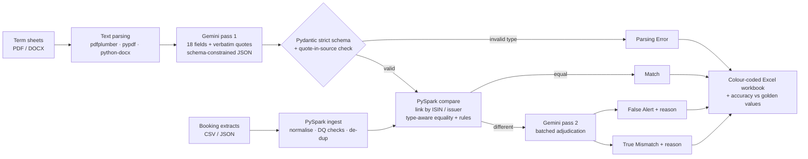

# LLM-Powered Term Sheet Reconciliation

Automated reconciliation of **unstructured bond term sheets (PDF / Word)** against **structured booking system extracts (CSV / JSON)**. It uses **Google Gemini** (free-tier API) for extraction and false-alert analysis, and **PySpark** for booking ingestion and comparison.



Every trade × field ends in one of these statuses: **Match**, **False Alert** (with reason), **True Mismatch** (with reason), **Parsing Error**. Values that can't be verified are tagged **Not in Term Sheet** or **Missing in Booking**. Unusual bookings are tagged **Outlier (Review)**.

---

## 1. Quick start

**Windows (PowerShell)**: one-step setup:
```powershell
git clone https://github.com/babitadokania/termsheet-reconciliation.git
cd termsheet-reconciliation
powershell -ExecutionPolicy Bypass -File scripts\setup_windows.ps1   # venv + deps + Java check + .env
notepad .env                                                       # paste GEMINI_API_KEY=...
.\.venv\Scripts\Activate.ps1
python run_pipeline.py
```

**macOS / Linux**
```bash
git clone https://github.com/babitadokania/termsheet-reconciliation.git
cd termsheet-reconciliation
python3.11 -m venv .venv && source .venv/bin/activate
pip install -r requirements.txt
cp .env.example .env            # paste GEMINI_API_KEY=...
python run_pipeline.py
```

The report is written to `output/reconciliation_report_latest.xlsx`.

> **No key?** `python run_pipeline.py --provider replay` replays the committed Gemini responses in `recordings/`, so you see real LLM output without a key or network. `--provider mock` runs a fully offline rule-based stand-in.

## 2. Prerequisites

| Requirement | Version | Notes |
|---|---|---|
| Python | 3.10 – 3.12 (3.11 recommended) | PySpark 3.5 support range |
| Java | JDK/JRE 17 (or 11) | Required by PySpark. Windows: [Eclipse Temurin 17](https://adoptium.net), tick *Set JAVA_HOME* |
| Gemini API key | free | [Google AI Studio → Get API key](https://aistudio.google.com/app/apikey) |

## 3. Configuration

Settings come from environment variables or `.env`. `.env` is git-ignored, and the key is never logged or written to outputs.

| Variable | Default | Purpose |
|---|---|---|
| `GEMINI_API_KEY` | – | Gemini key (`GOOGLE_API_KEY` also accepted) |
| `LLM_PROVIDER` | `auto` | `auto`: Gemini if a key is set, else replay if recordings exist, else mock. Or `gemini`, `replay`, `mock` |
| `GEMINI_MODEL` | `gemini-3.8-flash` | Any Gemini model available to your key. If Google retires a model, the client switches to the replacement Google names in its error |
| `GEMINI_STRUCTURED_OUTPUT` | `true` | Send the JSON schema to Gemini (`response_json_schema`). Falls back to plain JSON mode automatically if rejected |
| `LLM_MAX_RETRIES` / `LLM_TIMEOUT_S` | `5` / `120` | Exponential backoff + jitter on 429 / 5xx / timeouts / malformed JSON |
| `LLM_MIN_INTERVAL_S` | `4.0` | Throttle between calls (free-tier RPM) |
| `LLM_USE_CACHE` | `true` | Re-use responses for unchanged inputs (`output/llm_cache`) |
| `EXTRACTION_FALLBACK` | `true` | Use the regex extractor if Gemini is unavailable after retries |
| `TERM_SHEET_DIR` / `BOOKING_DIR` / `OUTPUT_DIR` | `data/term_sheets`, `data/bookings`, `output` | Input / output folders |
| `NUMERIC_TOLERANCE` | `1e-6` | Relative tolerance for numeric equality |
| `LOG_LEVEL` | `INFO` | Console verbosity (the log file always has DEBUG) |

## 4. Running

```bash
python run_pipeline.py                               # auto provider (see above)
python run_pipeline.py --provider gemini --record    # live Gemini, responses saved to recordings/
python run_pipeline.py --provider replay             # recorded Gemini responses, no key / network
python run_pipeline.py --provider mock               # offline rule-based demo
python run_pipeline.py --no-cache                    # force fresh LLM calls
python run_pipeline.py --term-sheets samples/word    # Word (.docx) term sheet demo
python scripts/evaluate_extraction.py                # score latest extraction vs golden values
python run_pipeline.py --help
```

**Pipeline steps**
1. **Parse** every `*.pdf` / `*.docx` in `data/term_sheets`.
2. **Gemini pass 1** extracts 18 fields in one schema-constrained call per document. Each field returns `{value, quote, confidence, note}`.
3. **Validate.** Each field is checked separately against the strict Pydantic schema. A wrong type becomes a **Parsing Error**, which is never compared. Every quote is checked to be present verbatim in the source; quotes that aren't are flagged.
4. **PySpark ingests** every `*.csv` / `*.json` in `data/bookings`. Column names are matched case-insensitively. Dates, numbers and lists are normalised, data-quality issues are logged, and identical CSV/JSON copies are de-duplicated (20 rows → 10 trades).
5. **PySpark compares.** Each trade is linked to its term sheet by ISIN, or by issuer when the term sheet has no ISIN. It is then unpivoted and compared by type: text, number within tolerance, ISO date, perpetual, or unordered list. Two rule checks also run on the notional (lot size, peer consistency).
6. **Gemini pass 2.** Mismatches are de-duplicated and sent in one batch. Each is classified **True Mismatch** or **False Alert**, with a reason and a confidence. If Gemini is unavailable, deterministic equivalence rules take over (units, formatting, synonyms, dates). They only call a False Alert when the values are provably equivalent, and every such verdict is labelled `rules-fallback`.
7. **Excel workbook** and audit files are written.

## 5. Inputs and outputs

**Inputs**
- **Term sheets.** Text-based PDF or DOCX, including two-column table layouts. Scanned PDFs need OCR first.
- **Booking extracts.** CSV with a header row, or JSON as `{"trades": [...]}`, a top-level array, or JSON-lines. Columns: `TradeID, ISIN, Issuer, Maturity, Notional, Coupon, Currency, SettlementDate, DayCountFraction, InterestPaymentDate, IssueDate, IssueAmount, IssuePrice, NominalAmountPerBond, InterestPaymentFrequency, BusinessDayConvention, BusinessDayLocation, AmortizationType, MinimumSubscription, Parent`. Dates may be ISO, `M/d/yyyy`, `14-Oct-2020` and so on.
- **Golden values** (`data/expected/<term sheet>.json`). Hand-verified correct answers, used to measure extraction accuracy.

**Outputs** (`output/`)

| Output | Content |
|---|---|
| `reconciliation_report_*.xlsx` → **Summary** | Run metadata (provider, model, prompt version), trade and field outcome counts, extraction accuracy, legend |
| → **Trade Summary** | One row per trade: **BREAK** / **REVIEW** / **CLEAN**, counts, breaking fields |
| → **Exceptions** | Only rows needing action |
| → **Reconciliation Detail** | Every trade × field: term-sheet value, booking value, initial result, final status, reason, verbatim evidence, LLM confidence |
| → **Term Sheet Extraction** | Raw LLM output per field: schema status, validation error, quote, quote-found-in-source flag |
| → **Extraction Accuracy** | Each field scored against golden values: Correct / Wrong / Missed / Hallucinated / Parsing error |
| → **Booking Data**, **Data Quality** | Normalised bookings; ingestion issues and extraction warnings |
| `extracted/*.json` | Validated extraction per document (audit trail) |
| `logs/run_*.log` | Full DEBUG log per run |

## 6. Results on the supplied data

Recorded live Gemini run (`--provider replay` reproduces it): extraction accuracy **36/36 fields** against the golden values.


| Trade | Result | Why |
|---|---|---|
| Genel 1, 5 | CLEAN | ISIN `NO 0010894330` vs `NO0010894330` → **False Alert** (formatting) |
| Genel 2 | BREAK | Maturity 2025-10-15 vs term sheet 14 Oct 2025 |
| Genel 3 | REVIEW | Notional 3,100,000 vs 3,000,000 on the other 4 trades (the term sheet can't confirm a trade size) |
| Genel 4 | BREAK | Coupon 9.50 vs 9.25% |
| IDBI 1 – 5 | BREAK | Booking has maturity 2025-10-17 but the bond is **perpetual** ; Gemini also flags the business-day convention (booking says only "Business day adjustment", term sheet specifies Following/Preceding rules) |
| IDBI 2 | BREAK | + Coupon 11.00 vs 10.75% |
| IDBI 3 | BREAK | + Notional 1,100,000 is not a whole multiple of the Rs.10,00,000 face value |
| IDBI 4 | BREAK | + Issue date 2014-10-10 vs deemed allotment 17 Oct 2014 |

Unit conversions such as Rs.1,500 Crores → 15,000,000,000 and 5 bonds × Rs.10 lakh → 5,000,000 reconcile to **Match**. Fields the IDBI term sheet doesn't state (ISIN, issue price, calendars, parent) are reported as *Not in Term Sheet*, not guessed.

## 7. Repository layout

```
├── run_pipeline.py              # entry point
├── src/tsrecon/
│   ├── config.py                # settings from env / .env
│   ├── schema.py                # strict Pydantic schema, field registry, Gemini JSON schema
│   ├── document_parser.py       # PDF / DOCX → text
│   ├── extractor.py             # LLM pass 1 + validation + evidence check
│   ├── heuristics.py            # regex extractor (offline mock + automatic fallback)
│   ├── llm/                     # provider interface, Gemini client, mock, cache/record/replay, prompts
│   ├── spark_session.py         # local SparkSession (Windows-friendly)
│   ├── booking_ingest.py        # PySpark ingestion, normalisation, DQ, de-dup
│   ├── reconcile.py             # PySpark linking, unpivot, comparison, notional rules
│   ├── adjudicator.py           # LLM pass 2
│   ├── results.py               # final classification + trade summary
│   ├── evaluation.py            # accuracy vs golden values
│   ├── excel_report.py          # workbook writer
│   └── pipeline.py              # orchestration + CLI
├── data/{term_sheets,bookings,expected}/
├── recordings/                  # recorded Gemini responses (replay mode)
├── samples/word/                # Word term sheet sample
├── sample_output/               # example workbook + extraction JSON
├── scripts/                     # setup_windows.ps1, evaluate_extraction.py, make_word_sample.py
├── tests/                       # 51 pytest tests (offline)
├── docs/                        # assignment brief, evaluation guidelines, REPORT.pdf
├── REPORT.md                    # 2-page write-up
└── Dockerfile, .github/workflows/ci.yml, pyproject.toml
```

## 8. Testing and code quality

```bash
python -m pytest                       # 51 tests, offline (~2 min): schema, parsing, LLM layer, Spark, end-to-end
pip install -r requirements-dev.txt
ruff check . && ruff format --check .  # lint + formatting
mypy                                   # type checking
```

GitHub Actions (`.github/workflows/ci.yml`) runs:
- lint and type checks;
- the tests, then an offline end-to-end run;
- a replay run whenever recordings are committed;
- a live Gemini run with an accuracy gate (`--min-accuracy 0.9`) when the `GEMINI_API_KEY` repository secret is set.

## 9. Troubleshooting

| Symptom | Fix |
|---|---|
| `Java was not found` | Install JDK 17 and set `JAVA_HOME`, then reopen the terminal |
| `Python worker failed to connect back` (Windows) | Run from the activated `.venv` with Python 3.11. The pipeline already points Spark at the current interpreter |
| `winutils.exe` / `HADOOP_HOME` warning | Harmless: Spark only reads files here, and outputs are written by Python |
| `Gemini ... 429` / quota | Free-tier limit. Retries are automatic. Raise `LLM_MIN_INTERVAL_S`, or re-run (cached calls are free) |
| `Gemini ... 400/401/403 - check GEMINI_API_KEY` | Invalid or restricted key. Create a new one in AI Studio |
| `No recorded ... response` in replay | Prompts or inputs changed since recording. Re-record with `--provider gemini --record` |
| Report not refreshed | Close `reconciliation_report_latest.xlsx` in Excel. The timestamped copy is always written |
| `running scripts is disabled` (PowerShell) | Use `powershell -ExecutionPolicy Bypass -File scripts\setup_windows.ps1`, or `Set-ExecutionPolicy -Scope CurrentUser RemoteSigned` |

## 10. Docker (optional)

```bash
docker build -t tsrecon .
docker run --rm -e GEMINI_API_KEY=$GEMINI_API_KEY -v "$PWD/output:/app/output" tsrecon
```

Design decisions, assumptions, challenges and productionisation notes are in **[REPORT.md](REPORT.md)** (PDF: `docs/REPORT.pdf`).
